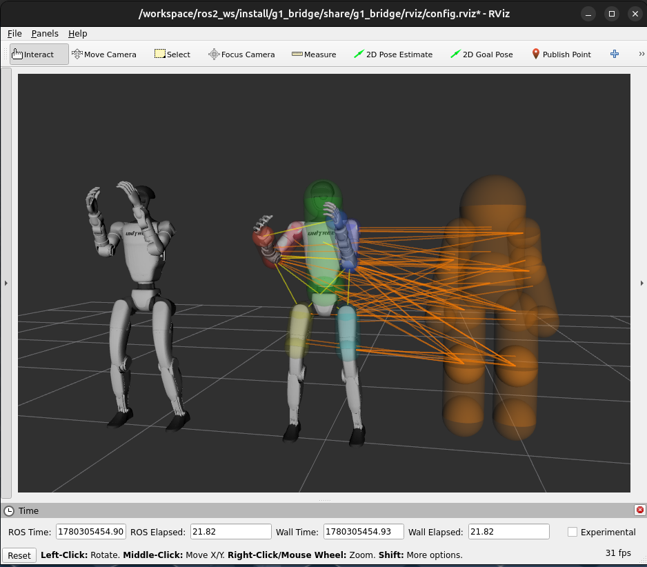
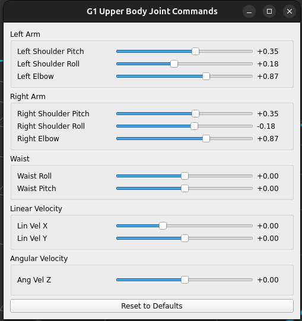

# g1_upperbody_ros2 
Low level control for a Unitree G1 robot implementing safe human imitation with CBF, along with lower body stability and velocity tracking via an RL policy. 

## Prerequisites

### Docker and NVIDIA Container Toolkit 

The package works on both x86 and ARM systems but require an NVIDIA GPU. Docker is used to streamline the installation process. If not already, please install docker and NVIDIA's docker container toolkit on your system. Thus, the following are required; 

1. [Docker](https://docs.docker.com/engine/install/)
2. [NVIDIA Container Toolkit](https://docs.nvidia.com/datacenter/cloud-native/container-toolkit/latest/install-guide.html)

### Simulator
This is designed to work with the unitree mujoco simulator. Please use the fork from the following repository and follow the setup instructions.

[https://github.com/Abanesjo/unitree_mujoco](https://github.com/Abanesjo/unitree_mujoco)

### Remote Controller
For safety especially when integrating with the real robot, the project is designed to work with a controller. This project is specifically calibrated for the Logitech F710 gamepad.

<p align="center">
    
</p>

## Usage

Install and build the docker container using the following command.

```
git clone --recursive https://github.com/Abanesjo/g1_upperbody_ros2
cd docker
docker compose up --build
```

If you are running on the Unitree G1's in-built computer or a jetson, build instead using: 

```
docker compose -f docker-compose-jetson.yaml up --build
```

Before proceeding, it's advised to wait until the container finishes compiling the ros packages, which is when you see the message

 **"g1_upperbody_ros2  | Summary: 11 packages finished [27.7s]"**

If not already, grant access to your display for docker applications

```
xhost +local:root
```

Next, enter the docker container

```
docker exec -it g1_upperbody_ros2 bash
```

This will give you access to the workspace within the container. The container already has tmux installed. So you can run

```
tmux
```

The ROS nodes communicate over Zenoh (`rmw_zenoh_cpp`) and only find each other through a Zenoh router. Start one in its own terminal within the container and keep it running:

```
ros2 run rmw_zenoh_cpp rmw_zenohd
```

The router reads its configuration from `src/RMW_ZENOH_ROUTER_CONFIG.json5`. With the router running, execute the following commands to test the functionality. 

### Motion from data

In one terminal within the container: 
```
ros2 launch g1_cbf bringup.launch.xml rviz:=true simulator:=true
```

To run on the simulator's clock (`use_sim_time:=true`, which the workspace and human-avoidance features need for the `world → pelvis` transform), start the simulator's clock and pelvis pose first, in a terminal of its own:
```
ros2 launch g1_navigation odom_simulation.launch.xml
ros2 launch g1_cbf bringup.launch.xml rviz:=true simulator:=true use_sim_time:=true
```

The launch files assume the stock rubber hands (`hand_type:=default`, with `robot: "g1"` in the simulator's `config.yaml`). For a robot with Inspire or Dex3 hands, add `hand_type:=inspire` or `hand_type:=dex` (and set `robot: "g1_inspire"` or `robot: "g1_dex"` in the simulator's `config.yaml`).

Only the bridge node talks to the simulator or the robot, and it does so with `unitree_sdk2` directly. With `simulator:=true` it expects the simulator on the loopback interface of this machine (`interface: "lo"` and `domain_id: 0` in the simulator's `config.yaml`). For the real robot, leave out `simulator:=true` and pass the network interface that is connected to the robot, for example `network_interface:=enp130s0`.

And in another terminal: 
```
ros2 launch g1_human g1_human_manual.launch.py
```

For several humans, add `num_humans:=3`. Each human gets its own control window, and they start in a row along the world y axis, `human_spacing` (default 1 m) apart.

For a crowd that walks around on its own, without control windows, use
```
ros2 launch g1_human g1_human_crowd.launch.xml num_humans:=20 use_sim_time:=true
```
The humans walk between random waypoints in a 10 m square around the origin (`side_length:=`, `center_x:=`, `center_y:=`), at 0.4 to 0.5 m/s (`min_speed:=`, `max_speed:=`), and `seed:=-1` draws a different crowd on every launch. The CBFs accept up to 100 humans, and the 385 nearest robot-human pairs (all pairs of five humans) go into the upper-body QP. The workspace circle (`world_circle_radius` in `g1_cbf/config/params.yaml`) has a radius of 5√2 m, so it passes through the corners of the default square.

You will see a window below



You can start the RL + CBF with the remote controller. See the [controller](#controls) section for usage instructions.

### Manual Motion

You can also send manual joint commands with the gui, as well as base velocities instead.

In one terminal within the container: 
```
ros2 launch g1_cbf bringup_manual.launch.xml rviz:=true simulator:=true
```
You will get an additional GUI as shown below. 



### Controller

For safety, the project utilizes a joystick for emergency kill switching and toggling between a default stand pose and the policy. The commands are as follows: 

```
LB: Kill Switch (toggles full damping mode)
RB: Toggles between default stand position and RL + Policy
```

### Stopping the container
You can stop the running container via
```
cd docker
docker compose down
```
from a host shell.
